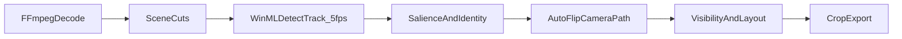

<p align="center">
  <a href="https://grepcut.com/en/open-clipper">
    
  </a>
</p>

<h1 align="center">Open Clipper</h1>

<p align="center">
  AI-powered video clipping and publishing by <a href="https://grepcut.com/">GrepCut</a>.
</p>

<p align="center">
  <a href="https://grepcut.com/en/open-clipper"><strong>Download for Windows</strong></a>
  | <a href="#features">Features</a>
  | <a href="#developing-from-source">Developer setup</a>
</p>

<p align="center">
  <a href="https://grepcut.com/en/open-clipper"></a>
  <a href="https://grepcut.com/"></a>
  <a href="https://discord.gg/2uXgrUpe"></a>
  <a href="https://x.com/GrepCut"></a>
  
  <a href="LICENSE"></a>
</p>

Free, open-source Windows desktop app for turning long videos into short, platform-ready clips. Local or cloud transcription (Whisper, Parakeet), scene-aware autoreframe, styled captions, and batch export to TikTok, YouTube, Instagram, and more.

> [!TIP]
> **Just want to use the app? Download the Windows installer.**
>
> Get the `.exe` from **[grepcut.com/en/open-clipper](https://grepcut.com/en/open-clipper)** and run it.
>
> To contribute or change the code, follow [Developing from source](#developing-from-source).

## Features

### From upload to transcript in one flow

Import your video, then transcribe with local **Whisper Large v3 Turbo** or **Parakeet**, or use cloud speech recognition with your **OpenRouter** or **Groq** API key. **MDX vocals isolation** runs locally before fresh transcription by default to help reduce music-related transcription errors. It applies to all audio, including audio sent to cloud providers.

[processing.webm](https://github.com/user-attachments/assets/1c0a85bc-8891-4638-89ec-622f351b18a5)

### Autoreframe engine

Face and subject detectors share one video decoding pipeline and use Windows GPU acceleration where available. The engine uses scene cuts and subject tracks to plan a camera path for each format. It can use split view when several subjects need to stay visible, depending on the format and layout rules. Preview **9:16**, **4:5**, **1:1**, and **16:9** from one source.

[reframe.webm](https://github.com/user-attachments/assets/137f5c0e-7eeb-4649-a700-66d7340786f2)

### Styled subtitles from your transcript

Choose from **20 caption presets**, including karaoke, kinetic, podcast, and gaming styles. Position and size them to match your brand.

[subtitles.webm](https://github.com/user-attachments/assets/32372ec2-1a9e-46f8-a18a-162c72cd144c)

### Batch render, one-click publish

Queue clips across formats and track render progress. Connect your channels to publish directly to **TikTok** and **YouTube**. Export files in formats for **Instagram**, **Facebook**, **X**, and other platforms for manual upload.

[render-queue.webm](https://github.com/user-attachments/assets/068b656b-4654-463c-b67d-78f7fc628900)

### Built-in clip editor

Every finished export has an **Edit video** button in Exports. The editor lets you trim and split the clip into parts, delete the parts you don't want, change the volume or mute it, add fade in/out, and place text overlays.

The **Captions** tab lets you fix caption wording line by line, remove lines, or hide captions. Edited exports remember their edit: opening one again continues from your cuts, text and caption fixes.

**Auto edit.** One button in the editor makes a first edit for you, each step switchable: cut long pauses and filler words (from the transcript's word timings), fix framing (shots where two people don't fit one crop switch to AI-tracked split screen), punch-in zooms on every other part, a hook title from the clip's title or first sentence, and volume levelling to a consistent speech loudness. It applies as normal edits you can review, tweak (each part has its own punch-in zoom) and undo in one step. In **Fix framing**, **Auto-fix** runs just the framing step.

**AI editor.** The editor's **AI** tab takes instructions in plain words ("cut the intro", "make it punchier", "add a hook and punch in on the punchline"). It works with Claude directly (paste an Anthropic API key in the AI tab; it uses the official Anthropic SDK and defaults to Claude Opus 5.5, with refusal fallback enabled), or with the OpenRouter or Groq key saved for cloud transcription (OpenRouter defaults to the newest Claude Sonnet; you can pick any chat model), sends the clip's numbered transcript, caption lines, shots and current edit, and applies the returned plan with the editor's own operations: word-accurate cuts, trims, pause and filler removal, punch-ins, on-screen text, caption rewrites, captions on/off, volume, fades and per-shot framing (including AI-tracked split screen). Each instruction is one undo step, and the history shows what was applied or skipped. Requests are billed by your provider.

**Fixing framing.** Use **Fix framing** in Preview (before rendering) or the editor's **Framing** tab. Framing is saved to the clip, so Preview, the render queue, every format and every re-render use it, and exports made before the change show as needing a re-render. It works shot by shot: shots come from the AI's scene cuts (you can add a shot change it missed), and a shot you don't touch keeps the AI framing. In a shot you can choose the layout (AI decides, always one shot, or always split screen), follow the AI camera with a nudge and zoom or place it manually (drag the preview). A forced split screen has two panels (stacked on vertical formats, side by side on landscape). By default the AI follows a person in each panel (left person in the top/left panel; **Swap people** flips them), using its face tracking with tighter smoothing than the full-frame camera; you set each panel's zoom and can drag inside a panel to nudge its framing. Switch the panels to **Manual** to place each one yourself. Where two people aren't detected, the panels fall back to their manual positions. Add keyframes to make the camera glide between positions within a shot. In the editor, **Split at shot changes** splits the clip into parts at every shot change.

**Music, sound effects, progress bar and cover.** The Edit tab can add background music (any audio file; it lowers itself while someone talks), a whoosh on cuts and a low hit on punch-ins (generated, no sound files needed), a progress bar along the top or bottom, and a cover: pick a frame, add a big title, and saving writes `<video>-cover.png` next to the export (optionally also shown for the first frames, for apps that use the first frame as the thumbnail). Music files are kept in the app's local storage so edits can be reopened.

**Keyword captions.** The Captions tab can highlight key words (numbers, names, strong words) in a colour that differs from the spoken-word highlight. Click words under the current line to toggle them, use **Pick automatically**, or let Auto edit or the AI editor do it.

**Speaker emphasis.** In an AI-tracked split screen, **Grow the panel of whoever's talking** watches mouth movement in each tracked face while words are spoken and gives the talking person's panel 62% of the frame, switching smoothly at each turn.

**AI across the project.** With an AI set up (an Anthropic key in any editor's AI tab), Preview's **Pick clips with AI** reads the transcript and saves the best moments as AI clips (choose how many, the length range and an optional focus). In Exports, **Write titles & hashtags** writes a hook title, descriptions and hashtags for every export, and **Edit all clips** runs Auto edit and/or one AI instruction on the newest version of every clip and saves each as a new export.

**Framing check.** Preview's **Check framing** finds the shots worth a look in every clip (a face cut by the frame edge, nobody in frame, someone left out, a shaky camera), worst first, each with **Fix**. The editor's Framing tab re-checks as you change things. More layouts: **Whole frame** (nothing cropped, a blurred copy fills the rest), **Screen + face** (a screen recording or slides shown uncropped, the presenter's face in its own panel; Auto edit uses it for screen recordings with a small webcam), and a **Slow zoom** push-in for any single shot.

**More editing.** **Hook** plays the clip's strongest line first as a teaser, then the clip from the start. **B-roll** puts an image or video over part of the clip (top part, full screen or picture in picture). Captions can get **emoji**, be **translated** into 19 languages (keeping their timing), have swear words **masked and bleeped**, and use their own **caption style** per clip. **Templates** save a clip's look (caption style, music, effects, progress bar, fades, keywords, emoji, hook) to apply to any clip or to all of them. The preview plays cuts, music, effects and bleeps as the saved video will.

**Premiere Pro.** The editor's **Premiere Pro** button writes an editable project next to your exports: a clean render (framing, no burned-in captions), an XML timeline with every cut and the hook as separate clips and the music on its own track (File → Import in Premiere), and an `.srt` of the captions.

**Local AI.** Every AI feature can run on your own computer: pick **Local model (Ollama / LM Studio)** in the AI tab (for example `ollama pull qwen3:14b`). Nothing leaves your machine and there's no per-request cost; bigger models follow edit instructions better.

**Colour, stabilising and voice.** The Edit tab's **Color** applies an automatic correction (exposure, contrast, saturation, colour cast, measured from the clip) and a look (Natural, Warm, Cool, Cinematic, Vibrant, Moody, Black & white, Vintage) under the captions. **Stabilize** removes camera shake from handheld footage, and **Voice** reduces background noise and rumble and evens out the level. With music, **Pulse on the beat** gives the picture a small zoom on the music's beats.

**Smarter framing and captions.** Punch-ins zoom towards the speaker's face. The render queue flags clips with framing warnings and can hold them back, and **Auto-fix all clips** (in Check framing) learns from the layouts you choose. Auto edit's **Tighten conversation** cuts pauses at a change of speaker extra short. The **caption designer** sets the font, colours, outline, effects and background box; **Chapter cards** adds AI title cards at topic changes; the render queue chooses which formats get burned-in captions and can save an `.srt` with every export.

**Across clips and projects.** **Score clips** (Exports) has the AI rate each clip's hook, pacing and payoff with one tip. **YouTube chapters** (Preview) writes timestamps for the long video. The home page searches what was said in every project and makes a clip from any hit. **Every format** (editor) saves an edit in all enabled formats at once. The project export (**Premiere / Resolve / FCP**) also writes a Final Cut Pro `.fcpxml`.

**Folder → draft.** On the home page, choose a folder with every file from a shoot: interview cameras, the sound recorder's files (a recorder that splits a long take into several files is fine), performance takes and B-roll. The app sorts them by sound (talking, music, silent), lines every file up (each through whatever it overlaps with), transcribes the recorder, has your AI (a local model works) build a story of the length you ask for, and writes `<folder>-draft.xml` (Premiere: File → Import; Resolve: File → Import → Timeline) and `<folder>-draft.srt` into the project folder. V1 holds the camera cuts, V2 the B-roll (placed where its file name is mentioned, else mid-answer), A1 the recorder (camera sound where no recorder covers), A2 each camera's own sound, muted, for checking sync; markers name the story parts. Separately recorded songs are placed whole. To finish in the app instead, reorder or remove parts, pick the camera per part, switch B-roll on or off, and render an MP4 (with burned-in captions if you like); the timeline files can be updated with the same changes. Auto camera changes at sentence breaks; on Windows, **Follow who's talking** finds each camera's main face and measures mouth movement, so the cut goes to whoever is speaking (interviewer or musician). Click a part to see its words: select some and **Keep only this** or **Cut this out** to trim inside it. The MP4 renders on the graphics card's encoder where there is one, at the size you choose (720p for a quick look). The last draft is kept, so you can come back to it.

**Watch folder.** On the home page, choose a folder: each new video dropped in it becomes a project that's transcribed, clipped and (optionally) rendered with no clicks, one at a time, while the app is open on the home page.

**Music interviews.** Edit tab → **Songs and performances** finds where music is playing: Auto edit never cuts inside a song, voice clean-up and background music step aside for it, songs can be brought to the talking level, and captions can be hidden during songs. **Camera angles** adds other cameras' recordings, lined up with the main camera by their sound, for chosen parts or automatically during songs (the Premiere / Resolve export puts them on V2). Parts can start their sound early or late (**J/L cuts**, with **J-cut into songs**). The **B-roll library** keeps a project's shots with tags (from file names, or an AI vision model) and suggests shots where a tag is mentioned. The **Text** tab cuts by sentence and finds **interviewer questions** to cut or turn into on-screen cards. **Lower thirds** and **song title** cards are text styles. In Preview, **Find performance moments** adds the strongest 20-40 s of each song and explain-then-play clips, and **Long-form edit** has the AI build a story from the whole interview with performances between topics.

Captions and framing are burned into exported files, so these changes re-render the clip from the project's source video; they are available while the project's video is loaded and the clip's start and end match the export.

Shortcuts: `Space` play/pause, `S` split at playhead, `Delete` remove selected part, `Ctrl+Z` undo, `←`/`→` step a frame (`Shift` for 1 second).

### Open the full video editor from Clipper

Get complete control, frame-level precision, and the freedom to make any fix or polish you want. Jump from Open Clipper into GrepCut Studio, the full online video editor.

[open-studio-from-clipper.webm](https://github.com/user-attachments/assets/7098a65d-8cdd-42f2-9da0-0570117b2e55)

## First-run setup

Before creating your first project:

1. Download the **vocals isolation model** in the setup screen (about 67 MB).
2. Download **Parakeet** or **Whisper** for local transcription, or save a **Groq** or **OpenRouter** API key for cloud transcription.

The setup screen requires the vocals model for both local and cloud transcription. The current settings screen has no switch to turn isolation off, although the stored configuration supports disabling it. You can manage model downloads and cloud keys in Settings.

## Developing from source

Skip this entire section unless you want to contribute or run the app from this repo. Everyday use is the Windows installer at [grepcut.com/en/open-clipper](https://grepcut.com/en/open-clipper).

### Prerequisites

Windows is the primary development target today. These tools are required only to build and run from source.

- [Node.js](https://nodejs.org/) **24** with npm
- [Rust](https://www.rust-lang.org/tools/install) **1.91 or newer**
- [Visual Studio 2022](https://visualstudio.microsoft.com/) or [Microsoft C++ Build Tools](https://visualstudio.microsoft.com/visual-cpp-build-tools/) with **Desktop development with C++** and the **Windows 10 SDK**
- [WebView2](https://developer.microsoft.com/microsoft-edge/webview2/) (required by Tauri 2 on Windows)
- [CMake](https://cmake.org/) and [Git](https://git-scm.com/) for the sherpa DirectML build
- Static **FFmpeg** via [vcpkg](https://vcpkg.io/) (`x64-windows-static`). The current configuration uses `C:\ffmpeg\vcpkg`. If your installation differs, adjust `VCPKG_ROOT`, `FFMPEG_DIR`, and the MSVC `linker` path in [src-tauri/.cargo/config.toml](src-tauri/.cargo/config.toml), plus the FFmpeg library search path in [src-tauri/build.rs](src-tauri/build.rs).
- The native libraries described in [DirectML (Windows GPU)](#directml-windows-gpu). The checked-in Cargo configuration points to the local sherpa DirectML build. Vocals isolation also needs a separate ONNX Runtime DLL.

### Development

Run these commands from the project root. Copy the example environment file if you do not already have a `.env` file:

```powershell
npm install
Copy-Item .env.example .env
```

The example uses `http://localhost:5000/api` for the GrepCut backend and `https://localhost:5173` for Studio. Set `VITE_API_BASE_URL` and `VITE_STUDIO_URL` in `.env` to the services you want to use. Account and publishing features need the backend; **Open in Studio** needs a running Studio instance. The backend and Studio are separate services and are not started by this repo.

Prepare the native dependencies using the DirectML instructions below, then start the app:

```powershell
npm run tauri:dev
```

`tauri:dev` starts Vite on `http://localhost:1420` via `beforeDevCommand`. Close any running `open-clipper.exe` before rebuilding to avoid file locks.

### Build

| Goal | Command | Output |
| ---- | ------- | ------ |
| Fast unsigned build, no installer | `npm run tauri:build:fast` | `src-tauri/target-fast/release/open-clipper.exe` |
| Fast build and launch | `npm run tauri:build:preview:fast` | Same EXE, then starts it |
| Full build with signed updater artifacts | `npm run tauri:build` | EXE in `src-tauri/target/release/`; installer in `bundle/nsis/` under that directory |
| Launch existing release build | `npm run tauri:preview` | `src-tauri/target/release/open-clipper.exe` |
| Launch existing fast build | `npm run tauri:preview:fast` | `src-tauri/target-fast/release/open-clipper.exe` |

`tauri:build:fast` skips the installer and updater signing requirements. It uses lighter Cargo flags (`LTO=off`, `opt-level=2`) and a separate `target-fast/` cache. Run the EXE from its build directory: it needs the accompanying runtime DLLs and model resources.

`tauri:build` requires `OPEN_CLIPPER_UPDATER_PUBKEY`, `OPEN_CLIPPER_UPDATER_ENDPOINT`, and either `TAURI_SIGNING_PRIVATE_KEY` or `TAURI_SIGNING_PRIVATE_KEY_PATH`. Set them in `.env`, `.env.production`, or the process environment. These keys sign updater artifacts, not Windows Authenticode signatures. Installer builds also stage the required runtime DLLs. For release preparation and verification, follow [Release Automation](release_automation/README.md).

Both build commands run `beforeBuildCommand`, which builds the frontend and stages the MCP executable. Files from `public/models` are excluded from `dist`. Speech and vocals models are installed separately through setup or Settings; vision models are bundled with the app.

### Faster builds on Windows

You can optionally exclude the Open Clipper Cargo caches from Windows Defender. Run **PowerShell as administrator** from the project root:

```powershell
$clipperTauriDir = (Resolve-Path .\src-tauri).Path
foreach ($cacheName in @("target", "target-fast")) {
  $clipperCachePath = Join-Path $clipperTauriDir $cacheName
  if (Test-Path -LiteralPath $clipperCachePath) {
    Add-MpPreference -ExclusionPath $clipperCachePath
    (Get-MpPreference).ExclusionPath -contains $clipperCachePath
  }
}
```

To undo:

```powershell
$clipperTauriDir = (Resolve-Path .\src-tauri).Path
foreach ($cacheName in @("target", "target-fast")) {
  $clipperCachePath = Join-Path $clipperTauriDir $cacheName
  if ((Get-MpPreference).ExclusionPath -contains $clipperCachePath) {
    Remove-MpPreference -ExclusionPath $clipperCachePath
  }
}
```

## MCP

Open Clipper exposes local project data to AI agents over two transports (no login):

| Transport | When it works                               | Endpoint                                                             |
| --------- | ------------------------------------------- | -------------------------------------------------------------------- |
| **HTTP**  | Desktop app is running                      | `http://127.0.0.1:12742/mcp` (override with `OPEN_CLIPPER_MCP_PORT`) |
| **Stdio** | Separate `open-clipper-mcp` process, no GUI | Full path to the staged binary (preferred in Cursor)                 |

Both transports use `%APPDATA%\com.openclipper.app\clipper.sqlite3` by default. The stdio process accepts `OPEN_CLIPPER_DB_PATH` to open a different database. That override does not change the desktop app's HTTP database.

**Clip picking:** In Preview, select the **MCP** tab. Call `list_projects`, then `get_project_transcript`, then `patch_ai_clips` using word indices. This mode uses an external MCP agent, has no in-app chat, and checks for clip changes about every 0.5 seconds while open. Use `get_ai_clips` to read existing selections.

**Export metadata:** Call `list_exports`, then `get_export_details`, then `patch_export_social_metadata`.

**Client setup:** The **MCP** tab provides connection details and a JSON configuration snippet. It includes stdio configuration when the app can find the MCP executable. Stdio is the recommended option for Cursor; HTTP is available while the desktop app is running.

**Build the stdio binary:**

```powershell
node scripts/stage-open-clipper-mcp.mjs
```

This runs automatically during `tauri:build` and `tauri:build:fast` (via `beforeBuildCommand`), but **not** during `tauri:dev`. It builds `open-clipper-mcp.exe` in the Cargo release directory and copies it to `src-tauri/bin/open-clipper-mcp-<triple>.exe`. The default Windows triple is `x86_64-pc-windows-msvc`.

Staging builds the executable for local use. The current installer configuration does not bundle it. An installed app uses HTTP unless a separate `open-clipper-mcp.exe` is placed beside the desktop executable. A development build can also find the staged copy in `src-tauri/bin`.

## Stack

| Layer      | Version |
| ---------- | ------- |
| Tauri      | 2.x     |
| React      | 19.x    |
| Vite       | 7.x     |
| TypeScript | 5.8.x   |

Bundle identifier: `com.openclipper.app`

## Reframe engine

The reframe engine creates a smart crop for each target format, such as 9:16. It adapts Google [AutoFlip](https://github.com/google/mediapipe/tree/master/mediapipe/examples/desktop/autoflip) to detect scene cuts, identify important subjects, and plan a camera path that follows them.

Analyzer version: `autoflip-v43-snap-layout-on-cut`. Vision bundle: `clipper-vision-v5-yolox-s-scrfd10g-tiled`.

### Two-tier pipeline

**Native (Windows):** FFmpeg decode and WinML/DirectML inference in [src-tauri/src/video/smart_crop/](src-tauri/src/video/smart_crop/), started via `start_clipper_winml_analysis`:

- Shot boundaries on every decoded frame (histogram + frame-diff)
- SCRFD face and YOLOX object detection at **5 FPS** (every 200 ms), with MoveNet pose detection as a conditional fallback
- **ByteTrack v2** on three streams (person / face / pose); trackers reset on scene cuts
- Motion measured across a grid on every detection sample to help locate important regions (no extra model)

**TypeScript graph:** [src/features/clipper/engine/autoflip/](src/features/clipper/engine/autoflip) (`buildAutoFlipTrack`):

- Match person, face, and pose tracks; remember subjects and rank their importance over time
- Plan a camera path for each format and scene using a polynomial or kinematic solver
- Choose crops and layouts, then store compact `layoutTracks` for preview and export



### Models

Vision model files ship in [src-tauri/resources/models/clipper-vision/](src-tauri/resources/models/clipper-vision/). They are bundled with the desktop app rather than downloaded from the model CDN.

| Model             | Role                                                  |
| ----------------- | ----------------------------------------------------- |
| YOLOX-S           | Person/object boxes; tiled recovery on long edge      |
| SCRFD-10G         | Face boxes + 5 keypoints; tiled recovery              |
| MoveNet MultiPose | Pose fallback; injects person boxes when YOLOX misses |

ByteTrack v2 is the tracking algorithm, not a downloaded model. It assigns a `trackId` within each person, face, or pose stream and resets on scene cuts. Motion measured across a grid also helps identify important regions without an extra model.

### Identity and composition

- `trackId`: ByteTrack trajectory on native detections
- `canonicalId`: scene-local fusion of person + face + pose (Hungarian assignment)
- `projectIdentityId`: clip-wide entity after full-clip observation (IoU association)

The engine remembers a YOLOX person detection only when a face or pose supports it. This helps filter out graphics and mannequins. That memory helps rank subjects across the clip without storing biometric embeddings.

### Camera path

Scenes come from native `sceneCuts`; long scenes are divided into smaller parts. Steady motion uses a polynomial path solver, while tracking motion uses a kinematic solver. Both are adapted from AutoFlip. The crop moves to keep important subjects visible. Its minimum zoom scale is `0.65`. Scenes shorter than 8 seconds keep the base crop size; the threshold is 1 second when the source and target aspect ratios already match. Tracks are stored at 5 samples per second, and the renderer fills in the motion between samples.

### Visibility and layout

Per-format layout modes: `single-crop`, `split` (2-3 panels), or `contain` (letterbox padding). Split layouts apply only to portrait/square targets; 16:9 never splits.

The engine tries shifted or wider crops, a crop focused on the main subject, and stable split layouts. It compares the resulting plan with the existing `aspectTracks` baseline before choosing a layout. Preview and export read compact `layoutTracks` keyed by aspect ID (`9-16`, `16-9`, `1-1`, `4-5`). The full analysis keeps diagnostics and layout comparison scores.

### Code map

| Area             | Path                                                                                                                                                                           |
| ---------------- | ------------------------------------------------------------------------------------------------------------------------------------------------------------------------------ |
| Native pipeline  | [src-tauri/src/video/smart_crop/](src-tauri/src/video/smart_crop/)                                                                                                             |
| Tauri command    | `start_clipper_winml_analysis` in [src-tauri/src/commands/clipper/video.rs](src-tauri/src/commands/clipper/video.rs)                                                           |
| AutoFlip graph   | [src/features/clipper/engine/autoflip/build-track.util.ts](src/features/clipper/engine/autoflip/build-track.util.ts)                                                           |
| Pipeline stages  | [analyze-faces.util.ts](src/features/clipper/pipeline/stages/analyze-faces.util.ts), [analyze-subjects.util.ts](src/features/clipper/pipeline/stages/analyze-subjects.util.ts) |
| Types and output | [src/features/clipper/shared/smart-crop.util.ts](src/features/clipper/shared/smart-crop.util.ts)                                                                               |

## Models

Download speech and vocals models from the setup screen or Settings. The normal desktop cache is `%APPDATA%\com.openclipper.app\models\`.

| Model | Directory name | Desktop lookup |
| ----- | -------------- | -------------- |
| Parakeet | `nemo-parakeet-tdt-0.6b-v3-int8` | Valid `PARAKEET_MODEL_DIR` or `SHERPA_ONNX_MODEL_DIR` override, then `public/models/` in debug builds, then AppData or the legacy cache |
| Whisper Large v3 Turbo | `whisper-large-v3-turbo-dml` | AppData only; no automatic `public/models/` fallback |
| MDX vocals isolation | `uvr-mdx-net-voc-ft` | Valid `OPEN_CLIPPER_VOCALS_MODEL_DIR` override, then AppData, then `public/models/` |

Each model directory must contain all required files. For offline development, prepare complete model directories and use the lookup locations above. Whisper files must be placed in its AppData model directory. MDX also accepts the older `OPEN_CLIPPER_DEMUCS_MODEL_DIR` override.

WinML vision models ship in `src-tauri/resources/models/clipper-vision/`. The build checks their hashes, and the installer includes them.

Speech and vocals model publishing uses the manifest and tools in [Models Automation](models_automation/README.md). Vision models are not included in that CDN upload.

## DirectML (Windows GPU)

On Windows, reframe vision, local speech recognition, and MDX vocals isolation use GPU acceleration where available. Vision uses the Windows WinML/DirectML stack. It does not need the custom sherpa build.

Parakeet and Whisper use `sherpa-onnx`. GPU speech recognition needs a DirectML-enabled build; stock prebuilt libraries are CPU-only. The speech runners can fall back to CPU if DirectML is unavailable.

### Speech recognition libraries

1. Install the C++ tools, Windows SDK, CMake, and Git listed above.
2. Build the native libraries:

   ```powershell
   npm run sherpa:directml
   ```

3. If you built the app before preparing these libraries, clear the old Cargo build cache:

   ```powershell
   cargo clean --manifest-path src-tauri/Cargo.toml
   ```

`npm run sherpa:directml` installs libraries in `third_party/sherpa-onnx-directml/install/lib`. It adds `SHERPA_ONNX_LIB_DIR` to [src-tauri/.cargo/config.toml](src-tauri/.cargo/config.toml) if the setting is missing. The checked-in configuration already points there. The native build copies the library DLLs beside the app executable.

### Vocals isolation runtime

Vocals isolation uses a separate ONNX Runtime from the one used by sherpa:

1. Download [Microsoft.ML.OnnxRuntime.DirectML 1.23.0](https://www.nuget.org/packages/Microsoft.ML.OnnxRuntime.DirectML/1.23.0) and extract the NuGet package under `third_party/onnxruntime-directml/1.23.0/`.
2. Check that `runtimes/win-x64/native/onnxruntime.dll` exists under that directory. Keep the x64 runtime dependencies available, including `DirectML.dll` and `onnxruntime_providers_shared.dll`. If downloaded separately, `DirectML.dll` comes from the package's `Microsoft.AI.DirectML` dependency.
3. Build or start the app using the commands above. The native build copies `onnxruntime.dll` beside the executable as `onnxruntime_ort.dll`, so it does not conflict with sherpa's `onnxruntime.dll`. If the supporting DLLs are missing from the build directory, copy them beside the executable. Installer builds stage runtime DLLs from that directory and require `DirectML.dll` to be present.

You can point `OPEN_CLIPPER_ORT_DLL` at an existing compatible runtime DLL instead. MDX prefers DirectML on Windows and can fall back to CPU when the provider is unavailable. Set `OPEN_CLIPPER_VOCALS_CPU=1` to force CPU processing. CPU processing still needs the ONNX Runtime DLL.

## Roadmap

### Completed

- [x] **Auto-updater and Cloudflare Releases:** in-app update checks and installs from Cloudflare-hosted releases
- [x] **Model hosting on Cloudflare R2:** speech and MDX vocals models use CDN delivery; vision models are bundled with the app
- [x] **Social provider verification:** provider review approvals for direct publishing
  - **TikTok:** app review approved (Production Live) and Direct Post audit approved (Content Posting API)
  - **YouTube:** approved (`youtube.upload` scope)
- [x] **Studio integration:** connect Open Clipper with GrepCut Studio
- [x] **MCP clip picking:** an external agent selects clips from transcript word indices and updates the preview

### Planned

- [ ] **MCP video presentation:** present videos via MCP
- [ ] **Additional MCP clip scoring:** extend the existing transcript-based clip selection workflow

## Contributing

Questions, bug reports, and feature ideas are welcome. [Join the Discord](https://discord.gg/2uXgrUpe) or [open an issue](https://github.com/GrepCut/OpenClipper/issues). Please follow our [Code of Conduct](.github/CODE_OF_CONDUCT.md).

## License

[MIT](LICENSE). Copyright 2026 GrepCut

The MIT license covers the Open Clipper source code. Bundled models and other third-party components have their own license terms. See the [vision model and tracker notices](src-tauri/resources/models/clipper-vision/MODEL_LICENSES.md).
